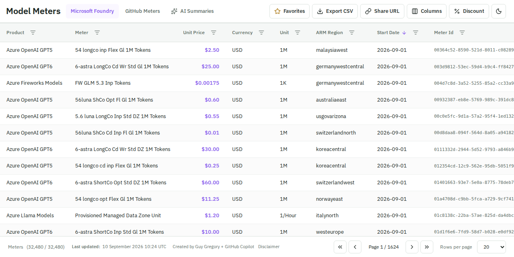
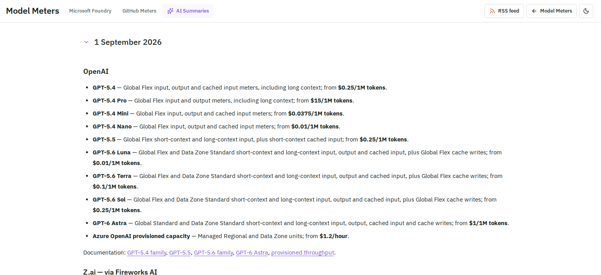

# Model Meters - Microsoft Foundry Pricing Explorer

[modelmeters.com](https://modelmeters.com) is a static pricing explorer backed by data downloaded from the [Azure Retail Prices API](https://docs.microsoft.com/rest/api/cost-management/retail-prices/azure-retail-prices). It presents Microsoft Foundry and GitHub meters alongside AI-generated summaries of Foundry pricing data.



## Cloud Champion overview session and slides (Microsoft Partners)


To watch the November 2025 Cloud Champion session associated with this tool, please browse to the recording [here](https://www.cloudchampion.co/c/using-azure-ai-foundry-and-github-services-to-build-modelmeters-com).

## Solution Overview

1. A daily GitHub Actions workflow downloads Foundry Models and GitHub pricing into separate NDJSON files.
2. The Foundry data is grouped by the date in `effectiveStartDate`; a smaller, deduplicated version of each group is prepared for summarization.
3. Missing summaries are generated with Azure OpenAI and Microsoft Learn MCP, then indexed for the summaries page and RSS feed.
4. The workflow commits generated files and requests an Azure Static Web Apps deployment when the commit contains changes.
5. Static browser pages display the downloaded prices and stored summaries; they do not query the pricing API live.

### Key Agentic AI Features

- **GitHub Actions Workflow**: Runs daily at midnight UTC to refresh pricing data
- **AI-Powered Summaries**: Uses Azure OpenAI to summarize date-grouped Foundry meters by model provider
- **Documentation Integration**: Uses [Microsoft Learn MCP Server](https://github.com/microsoftdocs/mcp) to automatically include relevant documentation links
- **Human-in-the-loop**: As AI summaries are stored in markdown format, this allows for quick and easy human review (and potentially AI agent review)



## Who Would Benefit From This?

This sample is designed to help Microsoft partners (and their customers) understand how they can:

- **Use GitHub and GitHub Copilot** to rapidly build a simple AI agent for data processing
- **Combine GitHub Actions with Microsoft Foundry** to automate repeatable tasks at scale
- **Use LLMs to enrich frequently updated structured data**, such as price lists, inventory, or sales data
- **Incorporate the use of Model Context Protocol (MCP)** within their solutions for enhanced AI capabilities
- **Build cost-effective monitoring solutions** for tracking Azure service pricing changes
- **Create automated reporting systems** that combine periodically refreshed data with AI-generated insights

## Technologies Used

### Core Technologies
- **[GitHub Copilot](https://github.com/features/copilot)** - AI-powered code completion and development assistance
- **[GitHub Actions](https://github.com/features/actions)** - CI/CD automation and workflow orchestration
- **[Azure Static Web Apps](https://azure.microsoft.com/services/app-service/static/)** - Static site hosting with integrated CI/CD
- **[Microsoft Foundry](https://azure.microsoft.com/products/ai-foundry/)** - AI model deployment and management platform
- **[Model Context Protocol (MCP)](https://modelcontextprotocol.io/)** - Protocol for AI model context sharing

### Development Stack
- **HTML/CSS/JavaScript** - Frontend web interface
- **Python 3.11** - Data processing and AI integration
- **OpenAI Python SDK** - AI model interaction
- **JSON/NDJSON** - Data storage and interchange formats

## Services Used

### Azure Services
- **[Azure Retail Prices API](https://docs.microsoft.com/rest/api/cost-management/retail-prices/azure-retail-prices)** - Official Azure pricing data source
- **[Azure OpenAI Service](https://azure.microsoft.com/products/ai-services/openai-service/)** - AI model hosting and inference
- **[Azure Static Web Apps](https://docs.microsoft.com/azure/static-web-apps/)** - Web application hosting and deployment

### AI Services
- **[Microsoft Learn MCP Server](https://learn.microsoft.com/api/mcp)** - Documentation context provider for AI summaries
- **[Responses API](https://learn.microsoft.com/azure/ai-foundry/openai/how-to/responses)** - AI response generation, with support for MCP

### GitHub Services
- **[GitHub Actions](https://docs.github.com/en/actions)** - Workflow automation and CI/CD
- **[GitHub Models](https://github.com/marketplace/models)** - Alternative AI model access through a separate script

## Costs

Running the static site locally does not require an Azure subscription. Generating summaries can incur model usage charges; hosting and GitHub Actions usage may also incur charges depending on your plan and usage. Check current provider pricing before deploying or generating summaries.

## Getting Started

### Prerequisites

- Python 3.11 for the documented scripts and local server
- Node.js and npm for the optional browser tests
- Network access to download fresh prices; an Azure OpenAI endpoint, key, and compatible model deployment are needed only to generate summaries
- An Azure Static Web Apps resource and GitHub repository are needed only for deployment

### Environment Setup

1. **Clone the repository**:
   ```bash
   git clone https://github.com/guygregory/modelmeters.com.git
   cd modelmeters.com
   ```

2. **Install Python dependencies** for summary generation:
   ```bash
   python -m venv .venv
   source .venv/bin/activate
   python -m pip install -r requirements.txt
   ```
   On Windows, activate the virtual environment with `.venv\Scripts\activate` instead.

3. **Configure Azure OpenAI** only if generating summaries:
   ```bash
   # Set environment variables
   export AZURE_OPENAI_API_KEY="your-api-key"
   export AZURE_OPENAI_V1_API_ENDPOINT="https://your-resource.openai.azure.com/openai/v1/"
   export AZURE_OPENAI_API_MODEL="your-deployment-name"
   ```
   Alternatively, place these values in an untracked `.env` file. Use a deployment that supports the Responses API and MCP tools. Keep credentials out of commits.

### Local Development

The checked-in data is sufficient to browse the site. From the repository root, serve it with:
```bash
python -m http.server 8000
```
Open `http://localhost:8000/` for Foundry prices, `/github/` for GitHub prices, or `/agent/` for summaries.

To refresh the generated data, run these steps from the repository root:

1. **Download pricing data** (this overwrites the two checked-in datasets):
   ```bash
   python meter-download.py --foundry-models-only --ndjson prices.ndjson
   python meter-download.py --github --ndjson prices-github.ndjson
   ```

2. **Process monthly data**:
   ```bash
   python split_into_monthly.py
   ```

   This groups Foundry records by `effectiveStartDate` into `monthly/full/` and produces deduplicated, reduced-field files in `monthly/partial/`. It does not process the GitHub dataset or remove old date files.

3. **Generate missing AI summaries** (requires the Azure configuration above):
   ```bash
   python create-ai-summaries.py
   ```
   Existing summaries are skipped even when their input changes. To regenerate a specific summary, use `python ai-summary.py --date YYYY-MM-DD --force`; `python create-ai-summaries.py --force` overwrites all summaries and may incur substantial API costs. The separate `ai-summary-github-models.py --date YYYY-MM-DD` script uses `GITHUB_TOKEN` and skips existing summaries; it is not an automatic fallback for the daily workflow.

4. **Refresh the summary index and RSS feed**:
   ```bash
   python monthly/generate-index.py array
   python generate-rss.py
   ```
   To regenerate the static archive at `monthly/index.html`, run `python consolidate-ai-summaries.py`. This is not part of the daily workflow.

### UI Development and Checks

The pricing explorers and summary pages share [site.css](site.css). The IBM Plex Sans font and Lucide icons are served locally from [img/fonts](img/fonts) and [img/icons](img/icons), with their license files. No application build step is required.

With the local Python server running in another terminal, run the browser regression suite:

```bash
cd tests
npm ci
npx playwright install --with-deps chromium
npm test
```

Set `MODELMETERS_URL` to test another server origin. The suite checks both pricing explorers, summary navigation, filtering, sorting, pagination, column visibility, discounts, CSV exports, shared URLs, themes, and desktop/mobile layouts. Screenshots are written to the ignored `tests/test-results/` directory. The summary pages retain their existing dependency on the marked.js CDN.

When changing the monthly archive layout, update [consolidate-ai-summaries.py](consolidate-ai-summaries.py) as well as [monthly/index.html](monthly/index.html) so regeneration preserves the presentation.

### Deployment

See the [deployment guide](.github/DEPLOYMENT.md) for workflow triggers, required secrets, and manual runs.

## Project Structure

```
├── index.html                  # Foundry pricing explorer
├── github/index.html           # GitHub pricing explorer
├── agent/                      # Summary page and RSS feed
├── monthly/
│   ├── full/                   # Foundry records grouped by effective date
│   ├── partial/                # Reduced, deduplicated summary inputs
│   └── aisummary/              # Markdown summaries and index.json
├── .github/workflows/          # Update, indexing, review, and deployment workflows
├── meter-download.py           # Azure Retail Prices API downloader
├── split_into_monthly.py       # Generate full and partial date groups
├── create-ai-summaries.py      # Generate missing summaries in bulk
├── ai-summary.py               # Azure OpenAI summary generation
├── ai-summary-github-models.py # Separate GitHub Models summary generator
├── consolidate-ai-summaries.py # Generate the static monthly archive
├── generate-rss.py             # Generate agent/rss.xml
├── prices.ndjson               # Foundry pricing data
└── prices-github.ndjson        # GitHub pricing data
```

## Features

### 🔍 **Interactive Pricing Explorer**
- Real-time filtering and search capabilities
- Sortable columns with customizable views
- Export functionality for data analysis
- Responsive design for mobile and desktop

### 🤖 **AI-Powered Insights**
- Summaries of Foundry meters grouped by effective date
- Model provider groupings and comparisons  
- Integration with Microsoft Learn documentation
- Contextual links to relevant resources

### ⚡ **Automated Updates**
- Daily data refresh via GitHub Actions
- Existing summaries are skipped by default to avoid repeated model calls
- Automatic deployment after an update commit

## Contributing

1. Fork the repository
2. Create a feature branch
3. Make your changes
4. Test locally using the setup instructions
5. Submit a pull request

## Disclaimer

⚠️ **Important Notice**:

- **Demonstration Purposes**: The site and code in this repository are for **demonstration purposes only**, not intended for production use
- **No Warranties**: No warranties, guarantees, or support is provided for this code
- **AI-Generated Content**: Summaries are AI-generated and could contain mistakes or inaccuracies
- **Authoritative Source**: Always refer to the [official Azure pricing page](https://azure.microsoft.com/pricing/) and price lists directly for authoritative pricing information
- **Data Accuracy**: While we strive for accuracy, pricing data may be delayed or incomplete
- **Usage Responsibility**: Users are responsible for validating any pricing information before making business decisions

## Support and Resources

- **Azure Pricing Documentation**: https://docs.microsoft.com/azure/cost-management-billing/
- **Microsoft Foundry**: https://docs.microsoft.com/azure/ai-foundry/
- **GitHub Actions**: https://docs.github.com/en/actions
- **Azure Static Web Apps**: https://docs.microsoft.com/azure/static-web-apps/
- **Microsoft Learn MCP Server**: [https://github.com/microsoftdocs/mcp](https://github.com/microsoftdocs/mcp)
